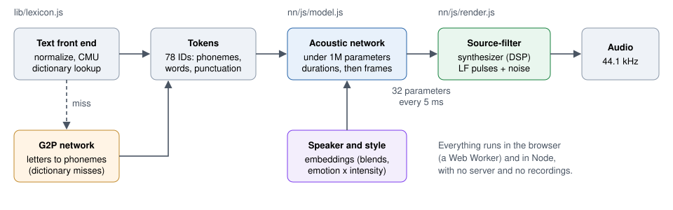

# Small Voices: Browser Speech Synthesis for Audiobooks

Craig A. Hobbs, with Claude (Anthropic)

October 2026 - a working paper, updated as the experiments it describes finish. Sections marked *in progress* report
interim results.


## Abstract

We build American English text-to-speech voices that run entirely in a web browser, for reading public-domain books
aloud, with models small enough to ship as part of a static web page. We first built a rule-based formant synthesizer
and calibrated it against measurements of 43 human speakers; listeners still rated it 1-2 out of 5 for naturalness.
We then replaced the rules - not the synthesizer - with a neural network of 748K parameters that predicts the
synthesizer's 32 interpretable parameters every 5 ms, trained end to end through a differentiable copy of the
synthesizer. The neural voices score 3.8-4.2 on an automatic naturalness predictor (UTMOS) against 4.1-4.3 for the
speakers' own recordings, a human listener rated them 3-4 out of 5, and in a blind test the listener judged the
neural male voice to be the real recording. Each voice is 812 KB and runs 10-14 times faster than real time in
JavaScript. We are now training a single multi-speaker, multi-style model of 966K parameters on 237 American
audiobook readers (52.7 hours) and 7,442 emotional clips, to design ten voices with emotional styles, and we describe
a method for finding each network's minimal size and packaging it as generated JavaScript.


## 1. Introduction

An audiobook player for the 2,000-book public-domain catalog we assembled (Standard Ebooks and Project Gutenberg) needs
voices that are pleasant for hours, intelligible, and free: no server, no per-character fees, no recordings to
license. The player is a static web page - it runs from GitHub Pages or `python3 -m http.server` - so the voices must
run in the browser, start speaking within a second, and fit in a page's download.

Modern neural text-to-speech systems sound excellent but are large (tens to hundreds of millions of parameters) and
usually need a neural vocoder or an audio codec to produce sound. Classic formant synthesis is tiny and fast but
sounds robotic. We take a hybrid path: keep a classic source-filter synthesizer as the sound generator, and train a
small network to drive it. The network's outputs remain interpretable - pitch, voicing, breathiness, formant
frequencies and bandwidths - so voices and speaking styles can also be shaped by simple transforms of its output.

The work proceeded in three stages, each judged by measurement: a rule-based synthesizer calibrated to human speech
(Section 4), a single-speaker neural parameter predictor (Section 5), and a multi-speaker, multi-style model now in
training (Section 7). Section 3 describes how we measure voices; Section 8 describes deployment.


## 2. System overview



1. **Text to phonemes** (`lib/lexicon.js`). The text is normalized (numbers, abbreviations, punctuation), and each
   word is looked up in the CMU Pronouncing Dictionary (about 135,000 words) for its phonemes and stress. Words the
   dictionary lacks currently go through a naive letter-based fallback; a neural replacement is in progress
   (Section 9.1).
2. **Phonemes to tokens** (`nn/js/tokens.js`). A fixed table maps phonemes and prosodic cues to 78 token IDs: the
   phonemes, word boundaries, a start marker, and punctuation tokens (comma, period, question, wh-question,
   exclamation) that tell the network how a phrase should rise, fall, or pause.
3. **Tokens to synthesizer parameters** (`nn/js/model.js`). The acoustic network predicts each token's duration and
   then, every 5 ms, 32 synthesizer parameters. A speaker embedding and a style embedding condition it.
4. **Parameters to audio** (`nn/js/render.js`). A source-filter synthesizer - Liljencrants-Fant (LF) glottal pulses
   and noise through resonant filters - renders 44.1 kHz audio. There is no neural vocoder.

Everything runs in JavaScript, in Node and in a browser's Web Worker, with no dependencies.


## 3. Evaluation method

We judge every acoustic change by measurement, using three instruments.

### 3.1 An automatic listener panel

A panel of pretrained models scores a fixed evaluation set (`tools/panel-texts.json`: six Harvard sentences, six
narrative passages with dialogue from public-domain books, two questions, and two exclamations):

| Listener | Model | Measures |
| --- | --- | --- |
| Naturalness | UTMOS22 (strong) | Predicted mean opinion score, 1-5 |
| Intelligibility | Whisper `base.en` | Word error rate (WER) against the text |
| Speaker identity | ECAPA-TDNN (VoxCeleb) | 192-dimension speaker embedding; cosine similarity |
| Style | emotion2vec+ base | Emotion probabilities (angry, disgusted, fearful, happy, neutral, sad, ...) |

We calibrated the panel on human and commercial speech before trusting it:

| Speech | UTMOS mean | WER |
| --- | --- | --- |
| Human - CMU ARCTIC speakers (bdl, rms, aew, slt, clb) | 4.28-4.39 | 2.7-4.7% |
| Human - LibriTTS-R audiobook readers (six) | 3.77-4.40 | 2.6-8.2% |
| Apple Samantha (unit selection) | 3.94 | 3.9% |
| Apple Daniel (unit selection, British) | 3.41 | 5.7% |
| Apple Fred (1980s formant synthesis) | 2.81 | 10.6% |

Two speaker-embedding facts guided later work: shifting a voice's pitch alone does not make a new speaker (similarity
0.99 to the original), while different human speakers score 0.0-0.5. On the CREMA-D emotional corpus (Section 7.1),
the emotion model recognizes the actors' intended emotion 86.8% of the time (unweighted recall 87.1%) - far above the
crowd's audio-only agreement of about 40%, which suggests CREMA-D was in its training lineage; we treat its scores on
our own voices as optimistic.

### 3.2 Human speech targets

To calibrate voices against real speech, we measure human recordings and our synthesized speech with the same
Praat-based analysis (`tools/targets.py`): F0 level, range, declination, and final falls; vowel formants F1-F4 at
20%, 50%, and 80% of each vowel; phone durations, articulation rate, and phrase-final lengthening; pauses per minute
and per punctuation mark; the long-term average spectrum; voice quality (H1-H2, H1-A3, harmonics-to-noise ratio,
jitter, shimmer, cepstral peak prominence); intensity dynamics; and fricative spectra. The targets are 43 speakers
from CMU ARCTIC and LibriTTS-R dev-clean. A voice is compared to one target speaker, or placed among the human
speakers of its sex as z-scores - which separates "another speaker's voice" from "something no human does".

### 3.3 Human listening rounds

A listening page (the Voice Lab) presents each round's samples - the same three passages from *Moby-Dick*, *Pride
and Prejudice*, and *Walden* in every round - for ratings of naturalness and listenability (1-5), A/B preferences,
and free-text notes. Round 3 added blind tests: a real recording of the speaker the network learned from beside the
network's rendering of the same sentence. One listener (the first author) has rated every round so far; the human
results are therefore indicative, and the automatic panel carries the quantitative comparisons.


## 4. Rule-based formant synthesis

### 4.1 The synthesizer

The baseline is a from-scratch JavaScript implementation of a Klatt-style cascade formant synthesizer with an LF
glottal source, driven by rules: Klatt's duration rules, a rule-based intonation model, and per-phoneme formant
targets with coarticulation. Voices are data (`lib/voices.js`): 80 documented parameters per voice, specs that
inherit from a base, and style transforms (scale, add, set, blended by intensity). The two voices, male and female,
started as one speaker's model with a pitch and formant shift - which the speaker-embedding panel saw through
(similarity 0.66 between them).

### 4.2 Calibration against human speech

We calibrated the rules in four tracks against the human targets, each integrated only if the panel did not regress:

- **Voice source and micro-dynamics**: replacing sinusoidal pitch and formant drift (an audible warble) with
  low-passed noise; F0 flutter; a breath-noise high shelf while voicing; louder accented syllables; jitter,
  breathiness, and Rd set from human voice-quality measures.
- **Rhythm and pauses**: phone durations fit to ARCTIC and LibriTTS-R rate-normalized durations, phrase-final
  lengthening, longer unstressed vowels, and audiobook-style pauses that grow with phrase length.
- **Vowels and consonants**: vowel tables fit to American speakers, back-vowel fronting after coronal consonants,
  late-gliding diphthongs, and corrected non-sibilant fricative spectra.
- **Intonation**: accent placement (given words, accent spacing, unaccented reporting verbs), a higher sentence
  onset, gentler declination carried across commas, livelier accents, and recalibrated final falls.

| Measure | Male before | Male after | Female before | Female after |
| --- | --- | --- | --- | --- |
| UTMOS (panel mean) | 3.16 | 3.14 | 3.25 | 3.33 |
| Whisper WER | 11.4% | 9.4% | 9.3% | 9.8% |
| Distance from the human population (RMS of z-scores) | 1.69 | 0.90 | 1.63 | 1.04 |

The calibration moved the voices most of the way into the human population on the measured statistics - roughly
halving their distance - but barely moved the naturalness predictor, and the human listener rated both rounds 1-2
out of 5 (Section 6). The listener's notes named the problem: "it sounds like a non-native English speaker -
intonations a little off - a little warble here and there." Measured gaps remained in liquids (about 2 dB weak),
intensity range, declination (-1.8 against -0.7 semitones per second), pause frequency (11-12 against 21-23 per
minute), and voice-source detail. Rule tuning had reached diminishing returns.


## 5. Neural parameter prediction

### 5.1 A differentiable source-filter synthesizer

To train a network to drive the synthesizer without hand-labeled formant targets, we wrote a differentiable version
of it in PyTorch (`nn/dsynth.py`), DDSP-style - no recursive filters:

- Voicing is harmonic synthesis: each frame's harmonic amplitudes are the product of the voicing level, the LF
  pulse's Fourier coefficients for the frame's Rd (a precomputed table), a source shelf, and the analytic frequency
  response of the vocal tract (six formants, a nasal pole and zero, higher poles) at each harmonic.
- The glottal phase is computed cycle by cycle on the CPU with jitter and shimmer; it is not differentiated (F0's
  gradient flows through the harmonic amplitudes).
- Aspiration and frication noise are shaped in the frequency domain (short-time Fourier transform, overlap-add).

A JavaScript renderer (`nn/js/render.js`) implements the same synthesizer and matches the PyTorch output sample for
sample when given the same noise.

### 5.2 The network

The model (`nn/model.py`, 748,251 parameters) is a small non-autoregressive network in the FastSpeech family:
token embeddings, an encoder of convolution and self-attention blocks, a duration predictor (log duration per
token, plus a pause probability and pause length at boundary tokens), a length regulator, and a convolutional decoder
whose head outputs two 5 ms parameter frames per 10 ms frame, each parameter squashed into its physical range. A
static 24-band channel equalizer per speaker models the recording channel. There is no absolute positional encoding,
so any length works; long texts are spoken a sentence at a time.

### 5.3 Training

Training runs end to end through the differentiable synthesizer against CMU ARCTIC recordings of one speaker (slt,
female; bdl, male; about 50 minutes each), with the recorded durations and recorded F0 (teacher forcing). The losses
are a multi-resolution STFT loss and a log-mel loss; duration losses (phone durations, pause classification, pause
lengths); an F0 regression loss on Praat's pitch (F0 gets no useful gradient through the synthesizer); and weak,
fading guides (formant targets from Praat, formant order, trajectory smoothness). Front-end tokens are produced
identically by the JavaScript and Python front ends, verified on 6,850 texts.

### 5.4 What limits quality

Two diagnostics located the ceiling:

- **Analysis by synthesis.** Fitting the synthesizer's parameters directly to each recording, frame by frame, with
  no network (`nn/fit.py`), reaches a UTMOS of about 3.84 - the best this synthesizer can sound under that fitting
  procedure, given the right parameters.
- **A prosody oracle.** Rendering the network's spectral parameters with the recording's own durations and pitch
  (`nn/oracle.py`) barely helps: prosody is not the limit; the spectral envelope is.

The network over-smooths formant bandwidths (and over-produces aspiration noise); narrowing the bandwidths to 0.6 of
their predicted values at inference raises UTMOS from about 3.6 to about 3.85. That fixed scale is a stopgap; the
multi-speaker training addresses the cause (Section 7).

### 5.5 Export and inference

Weights are quantized to 8 bits per row (one scale per row) and exported with a JSON manifest: 811,844 bytes per
voice. `nn/js/model.js` runs the network in plain JavaScript at 10-14 times real time in Node on an Apple M3 Max,
and the JavaScript and PyTorch outputs agree to within quantization.


## 6. Results

### 6.1 Objective scores

| Speech (held-out sentence and panel texts) | UTMOS |
| --- | --- |
| Human recording - ARCTIC slt (female) | 4.34 |
| Human recording - ARCTIC bdl (male) | 4.14 |
| Neural - bdl (male) | 4.07-4.21 |
| Neural - slt (female) | 3.79-3.99 |
| Analysis-by-synthesis ceiling | about 3.84 |
| Rule-based, calibrated | 3.49-3.54 |

Whisper transcribed the held-out sentence exactly from both neural voices.

### 6.2 Human listening

Mean ratings on a 1-5 scale, over the same three passages per voice (one listener):

| Round | Voices | Naturalness | Listenability | Preference |
| --- | --- | --- | --- | --- |
| 1 - baseline rules | male, female | 1.5 | 1.0 | dry over room ambience ("a little echo-y") |
| 2 - calibrated rules | male, female | 1.8 | 1.2 | calibrated over round 1, both voices |
| 3 - neural | bdl (male) | 3.7 | 3.7 | neural over calibrated rules, both voices |
| 3 - neural | slt (female) | 3.0 | 2.0 | "tinny and a little static" |

In the round-3 blind tests, the listener correctly picked the real recording for the female voice - and picked the
**network's** rendering as the real recording for the male voice.

The step from rules to a neural predictor of the same synthesizer's parameters mattered far more than all the rule
calibration: naturalness roughly doubled. The female voice's remaining defect matches the diagnosis of Section 5.4 -
over-smoothed bandwidths and excess high-frequency noise read as "tinny" and "static".


## 7. A multi-speaker, multi-style model (*in progress*)

The goal is ten voices (five female, five male) for reading many kinds of books - for example a warm literary
narrator, an older authoritative voice, a young bright voice, a brisk nonfiction voice, and a gentle voice - each
with emotional styles, from one model of about 1M parameters.

### 7.1 Data

- **American audiobook readers.** LibriTTS-R train-clean-100 and dev-clean (CC BY 4.0) plus four CMU ARCTIC
  speakers. An accent classifier (SpeechBrain's CommonAccent ECAPA model), run on 16 clips per speaker, kept speakers
  confidently classified as American: **237 speakers (120 female, 117 male), 52.7 hours**.
- **Emotional speech.** CREMA-D (ODbL): 91 actors, 12 sentences, 7,442 clips in six emotions (angry, disgusted,
  fearful, happy, neutral, sad) at several intensities. CREMA-D has no phone alignments; a wav2vec2 phoneme CTC model
  force-aligned all 7,442 clips with no failures.
- Each speaker's pitch range and formant ceiling were measured for the F0 and formant analysis, and each speaker's
  naturalness was scored (UTMOS, four clips each) to guide voice design.

### 7.2 Model and training

The architecture of Section 5.2 gains a learned speaker embedding table and a style embedding (one vector per emotion,
scaled by intensity, neutral at zero), both conditioning the encoder, duration predictor, and decoder. A voice at
inference can be any convex blend of speaker embeddings - so designed voices need not clone any one reader - and a
style any emotion at any intensity. The model has **965,803 parameters** (952,683 excluding the speaker and
equalizer tables). Training is staged: readers first (run `multi-a`, 30,000 steps at 0.28-0.44 s per step on the
Apple GPU), then the emotional styles. Over-smoothing is attacked directly - an adversarial spectrogram critic and
loss changes - instead of with the fixed bandwidth scale.

One incident is worth recording: the first launch of `multi-a` did not learn (losses flat through step 350) because
non-finite gradients came from logarithms of exactly-zero spectra in the spectral losses; a small epsilon fixed it,
and a 120-step smoke test confirmed falling losses before the relaunch.

### 7.3 Interim results

UTMOS of the stage-A checkpoints, reading the *Moby-Dick* opening (the single-speaker neural voices score 4.21 for
bdl and 3.99 for slt on the same text):

| Voice | A: step 5,000 | A: step 10,000 | A: step 15,000 | **B: step 5,000** |
| --- | --- | --- | --- | --- |
| Reader 2843 (male) | 3.82 | 3.75 | 3.99 | **4.22** |
| Reader 5750 (male) | 3.74 | 3.85 | 4.07 | **4.23** |
| ARCTIC bdl (male) | 3.73 | 3.71 | 3.98 | **4.24** |
| ARCTIC slt (female) | 3.61 | 3.78 | 3.97 | **4.23** |
| Reader 5895 (female) | 3.50 | 3.37 | 3.54 | **4.11** |
| Reader 6345 (female) | 3.38 | 3.42 | 3.59 | **4.09** |

By the end of stage A, one network for 237 speakers matched the dedicated single-speaker slt model (3.97 against 3.99).
Stage B - the emotional data plus an adversarial spectrogram critic with feature matching, aimed at the
over-smoothing behind the female voice's "tinny" sound - lifted every voice above 4.0 within 5,000 steps (female mean
3.70 to 4.14, male 4.02 to 4.23), past both single-speaker models (4.23 against 3.99 for slt, 4.24 against 4.21 for
bdl) and into the range of human recordings (4.1-4.3 on this predictor). Validation loss rose slightly meanwhile
(3.154 to 3.185): the critic trades spectral loss for realism. Because a neural judge and an adversarial critic may
reward the same artifacts, this result awaits human listening. The rest of stage B, the ten designed voices, and style
recognition rates will be added here.


## 8. Browser deployment

The audiobook player (`web/`) reads public-domain books from Standard Ebooks (EPUB, fetched in byte ranges) and
Project Gutenberg (plain text), with a 2,097-book catalog published as static JSON. Synthesis runs in a Web Worker,
a sentence at a time, streaming blocks of samples to the page so playback starts within about half a second
(567 ms from Play to playback in a headless-browser test at phone size; the 812 KB model loads when a book opens). Positions are
kept as character offsets into the book's text, so the player can skip by time, jump to chapters, bookmark, and
resume after a reload without having synthesized the audio in between.

**Packaging models as generated JavaScript.** Each network will ship as a generated JavaScript module: a small
manifest and the packed weights as base64, decoded (and, where it helps, decompressed with the built-in
`DecompressionStream`, which browsers and Node both provide) by one loader - so the same `import` works in Node, the
page, and the worker, with no `fetch` or file-system code. We measured that general-purpose compression barely helps
quantized weights: deflate shrinks the 8-bit voices by only 5% (812 KB to 775 KB), because quantized weights look
random. Base64 adds 33% raw but about 1% after the HTTP compression that static hosts apply to JavaScript. Size
reductions must therefore come from fewer parameters and fewer bits per weight (Section 9.2).


## 9. Ongoing work (*in progress*)

### 9.1 Neural grapheme-to-phoneme conversion

Dictionary misses are not rare in books, and they are the words that matter most - character names that repeat
hundreds of times:

| Book | Words missing from the dictionary | Most frequent misses |
| --- | --- | --- |
| *Moby-Dick* | 3.1% | Stubb, Queequeg, Pequod, harpooneer, Bildad |
| *Frankenstein* | 1.3% | Clerval, endeavoured, Safie, labours, Ingolstadt |
| *Pride and Prejudice* | 1.2% | Longbourn, Netherfield, Meryton, Pemberley, Rosings |
| *The Great Gatsby* | 1.1% | Wolfshiem, Klipspringer, Eckleburg |

The current letter-based fallback mispronounces them badly (Queequeg becomes `K AH1 EH1 K AH1 EH1 G`). We are
training a small letters-to-phonemes network on the dictionary itself, used only for misses, with a
British-to-American spelling pass in front of it. Across 22 books (2.36 million words), 1.86% of word tokens miss
the dictionary (11,956 distinct words); the spelling rules alone resolve 3.4% of those.

**An interim result.** A pilot network (an encoder-decoder of 178K parameters, 6,000 training steps; 37.6% word and
10.4% phoneme error on held-out dictionary words, which are mostly hard names) already changes how the books sound.
We spoke six sentences built from frequent misses with the neural male voice, with the old fallback and with the
pilot's pronunciations, and transcribed them with Whisper:

| Sentence | Old fallback, as Whisper heard it | Pilot network, as Whisper heard it |
| --- | --- | --- |
| *Pride and Prejudice* | "walked from lung bar into net hair failed ... saw Pemberle" | "walked from Longburn to Netherfield ... saw Pemberley" |
| *Moby-Dick* | "Clack-clack and stubs sailed on the peck-odd with TAS-TAGAW and DAGAW" | "Pekwigan stubs sailed on the Peekwad with Tashtego and Daggu" |
| *Moby-Dick* | "Captain Bill Dad ... the hair punters obeyed them" | "Captain Builded ... the Harpoon ears obeyed them" |

UTMOS rose from 3.96 to 4.05 (mean of the six). The pilot still errs (Klipspringer loses its "s"; "harpooneers" gains
a syllable), as its error rate predicts.

**Against the classical approach.** A Phonetisaurus joint-sequence WFST (a Kneser-Ney 7-gram over aligned
letter-phoneme pairs, trained on the same split) is more accurate than any neural model so far - 34.4% test word
error and 9.0% phoneme error, where order 7 is the plateau - but it is 9.1 MB in a compact 8-bit form (6.2 MB
gzipped). Size decides it for the browser:

| Model | Size | Test word error |
| --- | --- | --- |
| Neural pilot (178K parameters, 8 bits) | 164 KB | 38.0% |
| Neural encoder-decoder (657K parameters) | about 650 KB | 36.1% |
| WFST, pruned | 209 KB (gzipped) | 56.3% |
| WFST, pruned | 1.6 MB (gzipped) | 39.2% |
| WFST, full order 7 | 6.2 MB (gzipped) | 34.4% |

At equal size the network wins by about 18 points; the WFST needs 4-10 times the bytes just to match the pilot. The
two families also err differently: they agree on 58.5% of test words (right 85.8% of the time there), and an oracle
choosing the better of the two would reach 23.6%. We are therefore using the WFST as a free, deterministic teacher -
combined with the largest network - to distill a small student that aims to match the WFST's 34.4% in at most
about 200 KB. The results will be added here.

### 9.2 Minimal model sizes

Each network should be as small as its quality allows. The method, applied to the G2P network now and to the acoustic
model next:

1. Fix the quality measure and a tolerance before searching (for G2P: held-out word error rate, within 1 point of the
   best model; for the acoustic model: UTMOS within about 0.05 of the best, with WER and speaker similarity).
2. Sweep architectures and widths over a wide range of parameter counts, with several seeds, and record the Pareto
   front of size against quality.
3. Shrink the chosen point further by distillation from the largest model, by lower-precision quantization (8, 6, 5,
   and 4 bits with per-row or per-group scales), and by pruning - each kept only within the tolerance.
4. Measure size as the bytes of the final generated JavaScript module.
5. Size the data with the model: train each candidate size on fractions of the data (an eighth to all of it), and
   separately on more speakers versus more hours per speaker, to see where quality stops improving with data.
6. Clean the data first: score every training utterance with a trained checkpoint, review the worst (misalignments,
   wrong transcripts, noise), and keep an exclusion only if training without it measurably helps.
7. Stop each run when validation and the sample voices' UTMOS stop improving, rather than at a fixed step count.

Stage A of the multi-speaker model shows why the stopping rule must listen, not just read the loss: its validation
loss flattened near step 8,000 while its training loss kept falling (3.00 to 2.84 by step 15,000, validation 3.17 to
3.15) - yet the sample voices' UTMOS rose most in exactly that stretch, from 3.52 to 3.70 (female) and 3.77 to 4.02
(male) between steps 10,000 and 15,000, as the learning rate decayed. Validation loss is a poor proxy for perceived
quality here, so the stopping rule uses the sample voices' scores.

The current acoustic model's size (966K parameters) was chosen by judgment, not by such a search.

### 9.3 Training throughput

A profiling pass made a training step **1.73 times faster on fresh input shapes (0.430 to 0.249 s) and 2.07 times
faster once the GPU's shape caches are warm (0.295 to 0.142 s)**, measured in interleaved A/B runs while sharing the
GPU with a live run. The largest hidden cost was not computation: on Apple's GPU (PyTorch's MPS backend), every
blocking host-to-device copy waits for the whole GPU queue to drain - we measured 130-190 ms waits - and the baseline
made about 50 such copies and 25 device reads per step, so the CPU and GPU took turns.

| Change | Step time |
| --- | --- |
| Synthesizer: a batch-vectorized glottal cycle plan, non-blocking uploads, cached constants, shared filter trigonometry | (enables the next) |
| Each step's data, crops, and cycle plans prepared ahead on a thread; losses read only when logged | -14% |
| A fused AdamW that skips non-finite steps on the GPU (no per-step gradient-norm read) | -9.5% |
| A Metal kernel for the harmonic sum (no 570 MB phase and sine tensors) | -11% |
| Metal kernels for the vocal tract's response (14 resonators fused, analytic backward) | -17% |

The optimized code computes the same thing: step-0 losses are bit-identical; over 240-step training runs the curves
differ from the baseline by less than the baseline differs from its own rerun (MPS backpropagation is
nondeterministic); the Python synthesizer still matches the browser renderer; and a run with the multi-style
settings (emotional data, adversarial critic, feature matching) matches to 4-5 significant digits on every loss.
`torch.compile` was tried first; its backward pass fails on MPS. The optimizations were rolled into the live
multi-style run (stage B) at step 1,000.


## 10. Limitations

- One human listener has rated the voices so far; the human results are indicative only.
- UTMOS and the emotion model are imperfect proxies - UTMOS barely moved under rule calibration that a listener could
  hear, and the emotion model has likely seen CREMA-D.
- The source-filter synthesizer bounds the achievable quality (Section 5.4); neural vocoders avoid that bound at
  hundreds of times the size.
- Heteronyms ("read", "lead", "live", "wind", "tear") need sentence context; the front end takes the dictionary's
  first pronunciation.
- The voices are American English only, by design.


## 11. Data and licenses

| Data | Use | License |
| --- | --- | --- |
| CMU Pronouncing Dictionary | pronunciations; G2P training | BSD-style |
| CMU ARCTIC | single-speaker training; targets | CMU ARCTIC free license |
| LibriTTS-R (train-clean-100, dev-clean) | multi-speaker training; targets | CC BY 4.0 |
| LibriTTSLabel alignments | phone durations for LibriTTS | none stated - used locally, not redistributed |
| CREMA-D | emotional styles; emotion-model calibration | ODbL |
| Standard Ebooks, Project Gutenberg | the books read aloud | public domain |


## 12. Reproducing the results

```sh
make commit                                                     # tests, lint, docs, 100% coverage of lib/
make listeners                                                  # the listener panel's environment
node tools/panel.js -v male -v female                           # the panel on the rule voices
build/venv-analysis/bin/python -I tools/corpora.py              # the corpora
build/venv-analysis/bin/python -I tools/targets.py all          # the human speech targets
build/venv-nn/bin/python -B -m nn.train --speakers slt --name slt   # a single-speaker neural voice
node nn/js/speak.js -m data/nn/slt "Call me Ishmael." -o ishmael.wav
```

The training dashboard (`tools/dashboard/`) follows runs live: pipeline progress, loss curves, logs, and samples of
each checkpoint scored as it is saved.


## References

- D. H. Klatt, "Software for a cascade/parallel formant synthesizer," *JASA* 67(3), 1980.
- G. Fant, J. Liljencrants, Q. Lin, "A four-parameter model of glottal flow," *STL-QPSR* 4, 1985.
- J. Engel, L. Hantrakul, C. Gu, A. Roberts, "DDSP: Differentiable Digital Signal Processing," ICLR 2020.
- Y. Ren et al., "FastSpeech 2: Fast and High-Quality End-to-End Text to Speech," ICLR 2021.
- A. Łańcucki, "FastPitch: Parallel Text-to-speech with Pitch Prediction," ICASSP 2021.
- T. Saeki et al., "UTMOS: UTokyo-SaruLab System for VoiceMOS Challenge 2022," Interspeech 2022.
- B. Desplanques, J. Thienpondt, K. Demuynck, "ECAPA-TDNN," Interspeech 2020.
- Z. Ma et al., "emotion2vec: Self-Supervised Pre-Training for Speech Emotion Representation," ACL Findings 2024.
- A. Radford et al., "Robust Speech Recognition via Large-Scale Weak Supervision" (Whisper), ICML 2023.
- J. Kominek, A. W. Black, "The CMU Arctic speech databases," ISCA SSW5, 2004.
- Y. Koizumi et al., "LibriTTS-R: A Restored Multi-Speaker Text-to-Speech Corpus," Interspeech 2023.
- H. Cao et al., "CREMA-D: Crowd-sourced Emotional Multimodal Actors Dataset," *IEEE Trans. Affective Computing*, 2014.
- R. Escudero, P. Boersma, A. S. Rauber, R. A. H. Bion, "A cross-dialect acoustic description of vowels," *JASA*
  126(3), 2009.
- M. Iseli, A. Alwan, "An improved correction formula for the estimation of harmonic magnitudes," ICASSP 2004.
